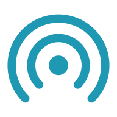

<h1 align="center">AleShare</h1>

Telefonunuzun mobil internetini bilgisayarınızla, tabletinizle ve diğer telefonlarla paylaşın.

  
  

  

AleShare, Android telefonunuzu kablosuz bir internet paylaşım noktasına dönüştürür. Telefon kendi Wi-Fi ağını açar; bağlanan cihaz interneti telefonun mobil verisinden alır. Bağlantı şifrelidir ve bağlanan cihazda proxy ayarı gerekmez.

Yapımcı: **furkanyela**

> [!NOTE]
> Arayüz oluşturulurken yapay zekâ araçlarından yararlanılmıştır.

## Özellikler

- **Proxy ayarı yok:** bağlanan cihazda bütün uygulamalar doğrudan çalışır.
- **Şifreli bağlantı:** cihazlar arasındaki bağlantı WireGuard ile, DNS sorguları HTTPS ile şifrelenir.
- **Kolay eşleşme:** cihazlar QR kodla eklenir; bilgisayar sonraki seferlerde kendiliğinden bağlanır.
- **Cihaz denetimi:** cihaz başına duraklatma, veri sınırı, hız sınırı ve kapalı saatler; süreli misafir erişimi.
- **Veri takibi:** günlük ve aylık kullanım, veri sınırı, hız testi.
- **Koruma ve tasarruf:** reklam ve izleyici engelleme, veri tasarrufu, akıllı öncelik, AleDPI modu, pil ve ısı koruması.
- **Güncelleme:** yeni sürüm yayımlandığında uygulama haber verir.

## İndirme

| Cihaz | Dosya | Gereksinim |
| --- | --- | --- |
| Android telefon ve tablet | [AleShare.apk](https://github.com/furkaanarslnn/AleShare/releases/latest/download/AleShare.apk) | Android 8.0 ya da üstü, 64 bit |
| Windows bilgisayar | [AleShare.exe](https://github.com/furkaanarslnn/AleShare/releases/latest/download/AleShare.exe) | Windows 10 ya da 11, 64 bit |
| iPhone, Mac ve Linux | | Geliştirilme aşamasında |

## Kurulum

### Telefon (interneti paylaşan)

1. `AleShare.apk` dosyasını indirip açın. Android'in istediği "bilinmeyen uygulamaları yükleme" iznini verin.
2. Uygulamayı açın, **Paylaşımı başlat**'a dokunun ve istenen izinleri verin.
3. Pil uyarısı çıkarsa **Düzelt**'e dokunun; böylece paylaşım ekran kapalıyken de sürer.

### Windows bilgisayar

1. Telefonda paylaşımı başlatın.
2. `AleShare.exe` dosyasını açın ve **Kuruluma başla**'ya tıklayın. Windows "bilinmeyen yayıncı" uyarısı gösterirse **Ek bilgi → Yine de çalıştır**'ı seçin.
3. Pencerede çıkan QR kodu telefonda **Cihazlar → Ekle → Bilgisayar** ile okutun.

Kurulumdan sonra bilgisayar, telefonda paylaşım başladığında kendiliğinden bağlanır.

### Tablet ya da ikinci Android telefon

1. Aynı `AleShare.apk` dosyasını bu cihaza da kurun.
2. Paylaşan telefonda **Cihazlar → Ekle → Telefon veya tablet**'e dokunun.
3. Diğer cihazda **Bağlan → QR kodu tara** ile kodu okutun ve **Kaydet ve bağlan**'a dokunun.

## Kullanım

Paylaşmak için uygulamayı açıp **Paylaşımı başlat**'a, bitince **Durdur**'a dokunmanız yeterlidir. Uygulamanın dört bölümü vardır:

| Bölüm | İçerik |
| --- | --- |
| **Paylaş** | Paylaşımı başlatma ve durdurma, Wi-Fi ağı, bağlı cihazlar |
| **Veri** | Günlük kullanım ve sınır, aylık paket, hız testi |
| **Ayarlar** | Koruma, tasarruf, Wi-Fi bandı, güncelleme |
| **Bağlan** | Bu cihazı başka bir telefonun paylaşımına bağlama |

Windows programı bağlantının durumunu ve telefonun bilgilerini gösterir; telefonun ayarları oradan da değiştirilebilir. Program, saatin yanındaki simgeden açılır.

Ayrıntılar

**Cihaz ayarları.** **Cihazlar** listesinde bir cihaza dokunarak o cihazın internetini duraklatabilir; günlük veri sınırı, hız sınırı ve internetin kapalı olacağı saatleri belirleyebilir ya da cihazı kaldırabilirsiniz.

**Misafir erişimi.** **Cihazlar → Ekle → Misafir** ile süreli ya da veri sınırlı erişim verilir. Süre ya da veri dolduğunda misafir kendiliğinden silinir.

**Ağ adı ve parolası.** Paylaşım açıkken **Wi-Fi ağı** kartındaki **Değiştir** ile değiştirilir. Bağlı cihazlar yeni ağa kendiliğinden geçer.

**Kısayollar.** Ana ekran aracı ve bildirim panelindeki hızlı ayar düğmesi, paylaşımı uygulamayı açmadan başlatır ve durdurur.

**Kaldırma.** Windows'ta pencerede **Gelişmiş → Kaldır**'a tıklayın. Android'de uygulamayı diğer uygulamalar gibi kaldırın.

**Komut satırı.**

| Komut | İşlev |
| --- | --- |
| `AleShare.exe status` | Durumu gösterir |
| `AleShare.exe check` | Daha yeni bir sürüm olup olmadığına bakar |
| `AleShare.exe autojoin on` / `off` | Otomatik bağlanmayı açar ya da kapatır |
| `AleShare.exe upgrade` | Bu dosyadaki sürümü mevcut kurulumun üzerine kurar |
| `AleShare.exe uninstall` | Programı kaldırır |

## Güncellemeler

- Yeni sürüm yayımlandığında uygulama ve Windows programı bildirim gösterir. İndirme siz isteyince başlar.
- Bir cihazı güncellemeniz yeterlidir; diğer cihazlar yeni sürümü paylaşan telefondan alır.
- Yalnızca bu projenin imzasını taşıyan dosyalar kurulur.

## Sorun giderme

- **Bilgisayar telefonun ağını görmüyor:** Wi-Fi'yi kapatıp açın. Ağ yine görünmezse telefonda **Ayarlar → Wi-Fi ağı → Bant** bölümünden 2,4 GHz'i seçin.
- **Bağlı görünüyor ama internet yok:** telefonda paylaşımın açık olduğunu ve mobil verinin çalıştığını denetleyin.
- **Paylaşım kendiliğinden duruyor:** telefonda Wi-Fi açık olmalıdır. Pil uyarısındaki **Düzelt** düğmesi arka plan kısıtlamasını kaldırır.
- **Bazı siteler açılmıyor:** **Ayarlar → Koruma ve tasarruf** bölümünde AleDPI modunu açmayı ya da reklam engellemeyi kapatmayı deneyin.

Çözemediğiniz sorunları [Issues](https://github.com/furkaanarslnn/AleShare/issues) sekmesinden bildirebilirsiniz.

## Gizlilik

- Hesap, reklam ve analiz yoktur; projeye ait bir sunucu bulunmaz.
- Hangi cihazın hangi adrese gittiği kaydedilmez.
- Sürüm denetimi GitHub'a yapılan küçük bir istektir ve ayarlardan kapatılabilir.

## Kaynak kod

Depo yalnızca kaynak kodu içerir; uygulamalar [Sürümler sayfasındadır](https://github.com/furkaanarslnn/AleShare/releases/latest).

| Klasör | İçerik |
| --- | --- |
| `android/` | Android uygulaması (Kotlin, Jetpack Compose) |
| `core/` | Go çekirdeği: WireGuard sunucusu, ağ geçidi, eşleşme, güncelleme |
| `core/cmd/hotspot-pc/` | Windows programı |

Derlemek için Windows'ta `.\build-android.ps1` çalıştırılır (Go, JDK 17 ve NDK'sı kurulu Android SDK gerekir). Yayın imza anahtarları depoda yoktur; bu nedenle başka bir yerde derlenen uygulama, yayımlanmış uygulamanın üzerine kurulamaz.

Nasıl çalışır?

- Paylaşan telefon, Wi-Fi Direct ile kendi kablosuz ağını açar.
- Telefonda kullanıcı alanında çalışan bir WireGuard sunucusu bulunur; her cihaz kendi anahtarıyla bağlanır.
- Tünelden gelen trafik, kullanıcı alanındaki bir ağ geçidiyle telefonun mobil verisine iletilir. Root yetkisi gerekmez.
- DNS sorgularını telefon yanıtlar ve HTTPS üzerinden çözer.
- Windows programı, resmî WireGuard for Windows hizmetini kullanır; yoksa kurulum sırasında indirip kurar.

## Lisans

Telif hakkı © 2026 furkanyela. Tüm hakları saklıdır.

Uygulamaları indirip kendi cihazlarınızda kullanmanız serbesttir. Kaynak kod incelenebilmesi amacıyla yayımlanmıştır; yazılı izin olmadan kopyalanamaz, değiştirilemez ve dağıtılamaz. Ayrıntılar [LICENSE](LICENSE) dosyasındadır.

Kullanılan açık kaynak bileşenler kendi lisanslarına tabidir; lisans metinleri uygulamaların içindedir (**Ayarlar → Hakkında → Açık kaynak lisansları**). WireGuard, Jason A. Donenfeld'in tescilli markasıdır; AleShare, WireGuard projesiyle bağlantılı değildir.

## Sorumluluk reddi

AleShare kişisel bir projedir ve "olduğu gibi", hiçbir garanti verilmeksizin sunulur. Yazılımı, mobil hattınızın kullanım koşullarına ve bulunduğunuz yerde yürürlükte olan kurallara uygun biçimde kullanmak kullanıcının sorumluluğundadır.
